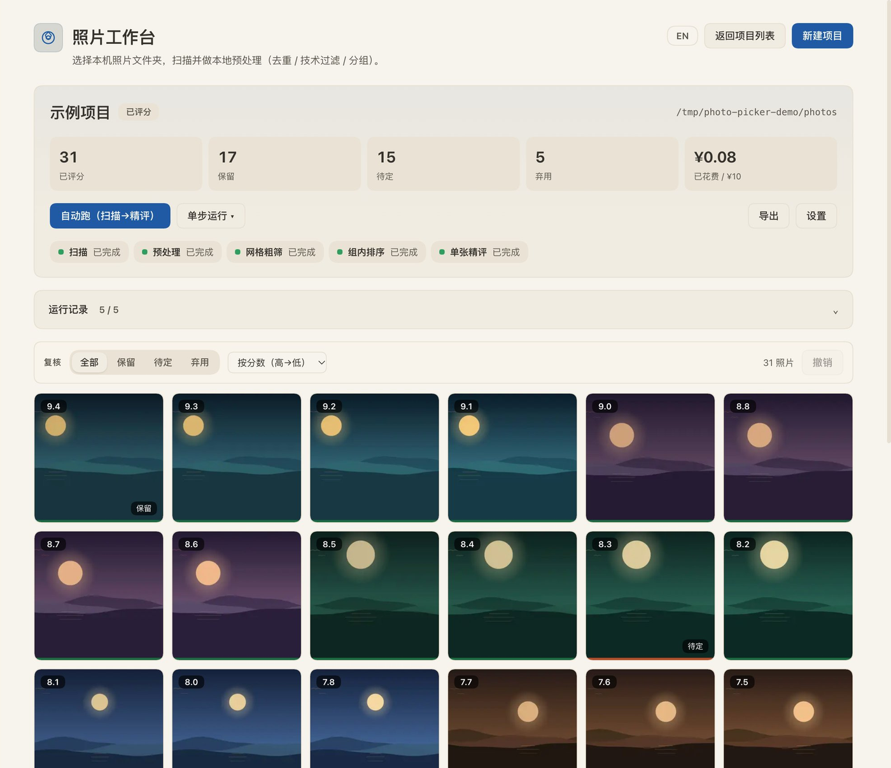
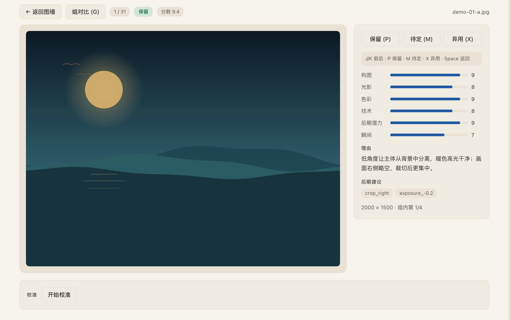
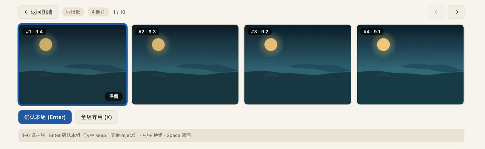
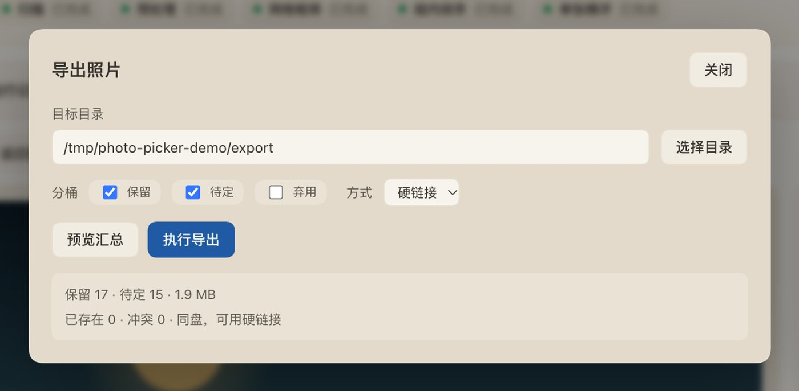

# 照片工作台 · dsh-photo-picker

> 一个长在 [DeepSeek Harness](https://github.com/deepseek-ai/deepseek-harness)（DSH）里照片挑选工作台：扫描本机照片，本地预处理去重/过滤/分组，AI 分层粗筛与精评，人工复核后把 keep / maybe 导出成可直接使用的目录。

**版本 0.0.1** · macOS · 本机优先 · 源目录只读

---

## 为什么做这个

现在拍照几乎零成本：手机随手拍、相机连拍、存储便宜，一次旅行或一场活动轻松就是几千甚至上万张。但**拍得越多，选片越痛苦**——人眼逐张过一遍既慢又容易疲劳，真正值得留下的往往只占很小一部分。

这个工具就是把「选片」拆成一条可以自动化的漏斗：

- 本地先做零成本的去重、技术过滤与连拍/同场景分组，把明显不需要的拿掉；
- AI 用「网格粗筛 → 组内排序 → 单张精评」逐层缩小范围，只把真正有竞争力的照片送进下一轮；
- 人工只复核收敛后的候选集，用图墙/单图/组对比快速做最终决定；
- 最后把 keep / maybe 直接导出成可用目录。

目标不是替你做决定，而是让你在几十分钟内看完真正值得看的那几百张。

## 它做什么

```
选照片文件夹
   │
   ├─ 扫描（EXIF / 文件清单）
   ├─ 本地预处理（sha256 去重、模糊/曝光/过小过滤、连拍与同场景分组、缩略图）
   ├─ AI 网格粗筛（4×4 拼图，每格 1 次调用，选出值得进入下一轮的照片）
   ├─ 组内排序（连拍/同场景只保留最好的 1–2 张）
   ├─ 单张精评（六维评分 + keep/maybe/reject + 后期建议）
   ├─ 人工复核（图墙 / 单图 / 组对比，批量改判与撤销）
   ├─ 校准（盲评 → 精确率 / 召回率 / F1 / 建议阈值）
   └─ 导出（硬链接或复制 + manifest，源目录零写入）
```

所有状态保存在本机 SQLite；任务可暂停、可断点续跑、AI 结果幂等不重复计费。入口是 DSH 左侧栏的「照片工作台 / Photo Picker」，界面语言默认跟随浏览器，可在主屏用「中 / EN」按钮切换。

## 界面预览



*项目详情：概览统计、五阶段进度、默认折叠的运行记录，以及按分数排序的复核图墙。*

| 单图复核 | 组对比 |
| --- | --- |
|  |  |
| 六维评分、判定理由、后期建议与快捷键。 | 连拍/同场景按分数排序，确认本组保留哪一张。 |



*导出：分桶、硬链接或复制，先 dry-run 预览数量与体积，再执行。*

> 截图使用本地生成的合成测试素材与模拟评分，仅用于展示界面，**不含真实照片、个人路径或账号信息**。

## 功能

- **照片源**：本机目录（macOS 原生选文件夹对话框 + 目录浏览）。SMB/NFS 网络源在路线图中。
- **本地预处理**：精确去重、模糊/曝光/分辨率过滤、dHash 连拍与同场景分组、384px 缩略图、1600px 预览按需生成。
- **AI 粗筛**：4×4 网格拼图（SVG 编号、不裁切），每格一次调用；解析失败会强化提示重试，仍失败的照片标记为 `grid_error` 进入人工队列，不会消失。
- **AI 精评**：组内排序（>6 张分块）→ 单张六维评分 → 阈值收敛；坏 JSON 自动重试，人工判定永远覆盖 AI。
- **预算与稳定性**：按 usage 实时计费、预算触顶暂停、并发/重试/退避、离峰开关、自动跑串联阶段、阶段间暂停、断点续跑。
- **复核**：图墙筛选/排序/多选改判/撤销最近 20 步；单图 1600px 预览、维度条、理由、后期建议；组对比 6 张/页；`J/K/P/M/X/Space` 快捷键。
- **校准**：按拍摄时间分层抽 80 张盲评，输出 keep 精确率/召回率/F1、三分类一致率、阈值曲线，可一键应用建议阈值。
- **导出**：keep / maybe / reject 分桶，硬链接（跨盘自动回退复制）或复制，保留目录结构或平铺，`manifest.csv` + `manifest.json`，导出前后抽样校验源文件未被修改。
- **设置**：题材、模型（图片输入能力检测）、并发、预算、网格规格、阈值、分组参数、阶段间暂停、离峰开关、提示词全文、重跑指定阶段。

## 环境要求

- **macOS**：HEIC/RAW 依赖系统 `sips`；选文件夹用 `osascript`；「在 Finder 中显示」用 `open`。
- **DSH Web profile**（创造者模式会话安装插件），Node **22.23+**（使用内置 `node:sqlite`）。
- 模型路由需支持**图片输入**（默认 `deepseek-official / deepseek-flash`）。不支持图片的模型会在设置里置灰。模型服务由使用者**自备**，插件不内置任何模型或凭据。
- 本仓库开发依赖：`sharp`、`exifr`、`nanoid`、`esbuild`；测试用 `node:test`。

## 安装

1. 克隆并安装依赖：

```bash
git clone https://github.com/uoiszero/dsh-photo-picker.git
cd dsh-photo-picker
npm install
```

2. （可选）修改客户端后重新构建；仓库已包含构建产物 `plugin/dist/client.js`：

```bash
npm run build:client
```

3. 在 DSH 的**创造者模式**会话里安装 bundle（需要批准）：

```text
plugin_manager action=install_bundle target=<abs-path>/dsh-photo-picker/plugin
```

4. 如果返回 `restart-required`，重启 DSH Web 后重开会话。侧栏出现「照片工作台 / Photo Picker」即安装成功。

> 插件安装在 profile 的 `link:` 依赖上，源码改动在 Host 侧需要 disable/enable 插件或重启 DSH；Client 侧重新 build 后刷新页面即可。

## 使用

1. 点侧栏「照片工作台」，右上角「新建项目」，选照片文件夹，设项目名/题材/预算。
2. 点 **自动跑（扫描→精评）**，整个流程会自动执行；结束会弹出完成/暂停提示，右侧检查点保留每阶段统计与抽样。
3. 需要单独控制时用 **单步运行** 菜单：扫描 / 预处理 / 网格粗筛 / 组内排序 / 单张精评。
4. 在「复核」区筛选 keep/maybe/reject，多选后批量判定；双击/点缩略图进入单图，`G` 进入组对比。
5. 觉得阈值不准时点 **开始校准**：盲评若干张后看报告，一键应用建议阈值。
6. 点 **导出**：选目标目录、分桶与硬链接/复制，先看 dry-run 汇总，再执行；完成后可直接在 Finder 中显示。

### 快捷键

| 位置 | 按键 | 作用 |
|---|---|---|
| 单图 | `J` / `K` | 下一张 / 上一张 |
| 单图 | `P` / `M` / `X` | 保留 / 待定 / 弃用 |
| 单图 | `G` | 进入组对比 |
| 单图 | `Space` / `Esc` | 返回图墙 |
| 组对比 | `1–6` | 选中本页某一张 |
| 组对比 | `Enter` | 确认本组（选中 keep，其余 reject） |
| 组对比 | `X` | 全组弃用 |
| 组对比 | `←/→` | 上一组 / 下一组 |

## 架构

```
Harness Web UI
└── Client 插件（侧栏菜单 + 主区域页面，React）
      │  HTTP（loopback）+ SSE
┌─────▼──────────────────────────────────────────────┐
│ Host 插件 dsh-photo-picker（Cordis）                │
│  PhotoPickerService（ctx.photoPicker）              │
│  source.js  本机只读照片源                           │
│  scan.js → preprocess.js                            │
│  pipeline.js + grid.js + llm.js + parse.js          │
│  review.js / calibration.js / export.js             │
│  orchestrator.js（自动跑 / stagePause）              │
│  storage：node:sqlite + 本地缩略图/预览/网格图        │
│  webServer：HTTP API + 媒体路由 + SSE                │
│  tools：photo_picker / photo_picker_export           │
└─────────────────────────────────────────────────────┘
```

- **单一事实来源**：所有状态在项目 SQLite（`~/Pictures/PhotoPicker/<项目>/db.sqlite`）；Client 与 agent 工具读写同一服务。
- **判定优先级**：人类决策 > AI 决策 > 单张评分 > 默认 `maybe`。
- **数据表**：`projects / photos / groups / grids / stage_runs / assessments / decisions / exports / errors / mounts / calibration_reports`。
- **幂等**：扫描按 `(project_id, rel_path)` upsert；AI 结果按 `(target_kind, target_id, stage, model_id, prompt_version)` 去重；重跑只补缺、不重复计费。

### 主要 HTTP API（loopback，仅本机）

| 路由 | 用途 |
|---|---|
| `GET/POST /photo-picker/api/projects` | 列表 / 建项目 |
| `GET/PATCH /photo-picker/api/projects/:id` | 详情 / 改设置 |
| `POST /photo-picker/api/projects/:id/actions` | 单阶段、`pause`、`cancel`、`run_all` |
| `GET /photo-picker/api/projects/:id/photos` | 图墙（筛选/排序/分页） |
| `GET /photo-picker/api/projects/:id/photos/:pid` | 单张详情（含组内排名） |
| `POST /photo-picker/api/projects/:id/decisions` | 人工改判（`auto` 可撤销到自动判定） |
| `GET /photo-picker/api/projects/:id/groups[/:gid]` | 组列表 / 组详情 |
| `GET /photo-picker/api/projects/:id/stats` | 判定计数 + 分数直方图 |
| `GET /photo-picker/api/projects/:id/checkpoints` | 阶段检查点 |
| `GET/POST /photo-picker/api/projects/:id/calibration[/sample]` | 校准样本 / 报告 |
| `POST /photo-picker/api/projects/:id/export/preview\|run` | dry-run / 导出 |
| `GET /photo-picker/api/prompt`、`/models` | 提示词全文 / 模型目录 |
| `GET /photo-picker/media/thumb\|preview/...` | 缩略图 / 预览图 |
| `GET /photo-picker/api/projects/:id/events` | SSE 进度与费用 |

## 费用与隐私

- **参考价格**（本机 cost-meter，2026-11）：离峰输入 ¥1/M、输出 ¥4/M、缓存命中 ¥0.02/M；工作日 9–12、14–18 高峰 ×2。5 万张、保留 25%、粗筛入选 30% 的量级，离峰大约 **¥5–10**（默认预算 ¥30）。
- 实际费用按每次响应的 usage 结算；到达预算会暂停在检查点，可以自行提高预算继续。
- **照片只在评估时以缩放后的网格图/单图发送给模型**；不上传原文件、EXIF 全量或数据库。API Key 由 DSH 凭据提供，插件不读取、不落库。
- 源目录**只读**；导出目标由用户显式选择；HTTP 只监听 loopback。

## 免责声明

- **自备模型**：本项目只提供本机照片管理与 AI 辅助筛选的工作台，**不内置、不代理、不转售任何模型服务**，也不附带模型权重或 API Key。使用者需自行准备模型服务（账号、凭据与额度），并自行承担调用产生的费用。
- **第三方条款**：通过 DSH 路由或任何第三方模型服务使用本插件时，必须遵守对应提供方的用户协议、服务条款、可接受使用政策、隐私政策与计费规则。不同模型和地区对图片输入、人物照片、生成内容的要求不同，请在使用前自行确认。
- **责任边界**：开发者不控制第三方模型服务，不对模型输出、服务可用性、费用争议、数据合规、隐私、版权或使用过程中产生的其他法律风险承担责任。请在符合当地法律法规与平台条款的前提下使用；涉及人物照片、敏感场景或商业交付时，请自行取得必要授权，并对最终结果做人工复核。
- **按现状提供**：本项目按「现状」（as-is）提供，不附带任何明示或默示的担保。本节不构成法律意见，如有疑问请咨询专业法律人士。

## 开发

```bash
npm install              # 安装依赖
npm test                 # 83 个单元/集成测试（node:test）
npm run typecheck        # TSX 类型检查（tsc --noEmit）
npm run build:client     # 打包 plugin/src/client -> plugin/dist/client.js
npm run fixtures         # 生成 120 张测试夹具到 /tmp/pp-fixtures
npm run acceptance:1     # 本机扫描/预处理验收
npm run acceptance:2     # AI 流水线端到端（mock LLM，不产生费用）
npm run acceptance:4     # 复核/改判/导出/源零写入验收
npm run check:release    # 三处版本号一致（打 tag 时还要与 tag 一致）
npm run check:hygiene    # 个人路径 / 密钥 / 数据库 / 本地 file: 依赖
npm run verify           # 以上全部串一遍，与 CI 同一套门禁
```

- Host 侧是普通 ESM JavaScript（不编译）；Client 是 TSX，由 esbuild 打包成 DSH 的 `window.__ModuleLoader__` 格式并提交。
- 测试与验收脚本都不会调用真实模型；需要真实调用时请自行确认费用（16 张真实照片约 ¥0.05）。
- 更多实现细节、验收记录与后续计划见 [`docs/superpowers/`](docs/superpowers/)。

### CI

GitHub Actions（`.github/workflows/ci.yml`）在 push 到 `main` 与 PR 上跑三个 job：

| job | 内容 |
| --- | --- |
| `checks`（ubuntu） | `npm ci` → 测试 → 类型检查 → 版本/卫生检查 → 构建客户端，并断言 `plugin/dist/client.js` 与源码同步 |
| `acceptance`（ubuntu） | fixture + `acceptance:1/2/4`（假 LLM，零费用、无密钥） |
| `windows` | `npm ci` → 测试 → 类型检查 → 版本/卫生检查 → 构建客户端（Windows 路径与平台层回归） |
| `macOS` | 主平台回归：测试 + 三个验收脚本 |

`main` 已启用规则集：改动必须走 PR，上表三个 job 全绿才能合并；禁止强推和删除分支。发布 tag 不受规则集限制。

打 `v*` tag 时 `release.yml` 会重跑完整门禁，并把 `plugin/` 打成 `dsh-photo-picker-vX.Y.Z.tar.gz` 附到 GitHub Release（解压目录即可作为 `plugin_manager action=install_bundle` 的 `target`）。CI **不会**调用真实模型，也不做创造者模式安装与浏览器验证，这两步仍按 [`AGENTS.md`](AGENTS.md) 手工执行。

### 目录结构

```
plugin/
├── index.js                # Host 入口
├── cordis.patch.yml        # bundle 安装时插入的 Loader 行
├── package.json            # bundle 清单（dsh.bundle / dsh.client）
├── locale/{zh,en}.json     # 插件元数据文案
├── src/host/               # 服务、扫描、预处理、AI 流水线、复核、校准、导出
├── src/client/             # 工作台 UI（React + TSX）与词典
├── dist/client.js          # 构建产物
└── test/                   # node:test 测试
scripts/                    # 构建、夹具、验收脚本
docs/superpowers/           # 设计 spec 与执行计划
```

## 后续计划

1. **Windows 系统支持**
   当前依赖 macOS 的 `sips`（HEIC/RAW 解码）、`osascript`（选文件夹）和 `open`（在 Finder 中显示）。已完成平台适配层（macOS / Windows 双实现）与 `windows-latest` CI；Windows 侧走 WIC 解码、PowerShell 目录选择与 `explorer /select`，原生对话框、HEIC/RAW 扩展与长路径仍需在 Windows 虚拟机上做真机验收。

2. **更精确的修图建议（PS Actions）**
   现在只给出白名单形式的后期代码（`crop_right`、`exposure_+0.3`、`straighten_+1.5` 等）。计划让模型输出更具体的参数与区域，并生成可直接执行的 Photoshop Action（`.atn`）或脚本，把「建议」变成「一键套用」。

3. **人物识别分组**
   按人物聚合同一场活动/婚礼里的照片，方便逐人筛选与交付。计划在本地做人脸检测与特征聚类（照片不出本机，可选开启），并把人物分组接进现有的图墙、组对比与导出流程。

## 已知限制

- 目前仅支持 **macOS**（Windows 支持在后续计划中）；Windows 不是当前的一等公民。
- **Windows 系统目录对话框可能显示在 DSH 窗口下层**（UTM + Win11 ARM 上已复现）：已加 TopMost owner 与单飞防止重复弹窗，但个别窗口环境仍需 `Alt+Tab` 或最小化 DSH 才能看到对话框。
- **网络源（SMB/NFS）尚未实现**（计划中的下一块）：目前只支持已挂载到本机路径的目录。
- 图墙一次最多取 200 张，尚未做虚拟滚动；超大项目建议用筛选收敛。
- 组对比每页 6 张，超过需要翻页。
- 校准复用已经评分的照片，不会为了校准重新跑一遍 L1–L3。
- 插件面向单用户本机，没有多人协作/权限体系。

## 文档

- 设计 spec：[docs/superpowers/specs/2026-11-04-photo-picker-workbench-design.md](docs/superpowers/specs/2026-11-04-photo-picker-workbench-design.md)
- 执行计划：
  - [Plan 1：骨架与本机预处理](docs/superpowers/plans/2026-11-04-photo-picker-01-foundation.md)
  - [Plan 2：AI 批量流水线](docs/superpowers/plans/2026-11-04-photo-picker-02-ai-pipeline.md)
  - [Plan 4：复核、改判与导出](docs/superpowers/plans/2026-11-04-photo-picker-04-review-and-export.md)

## 版本

0.0.1（首个可运行版本：本机照片 → AI 分层筛选 → 人工复核 → 导出）。

## 许可证

本项目采用 [MIT 许可证](LICENSE)。Copyright (c) 2026 uoiszero。
