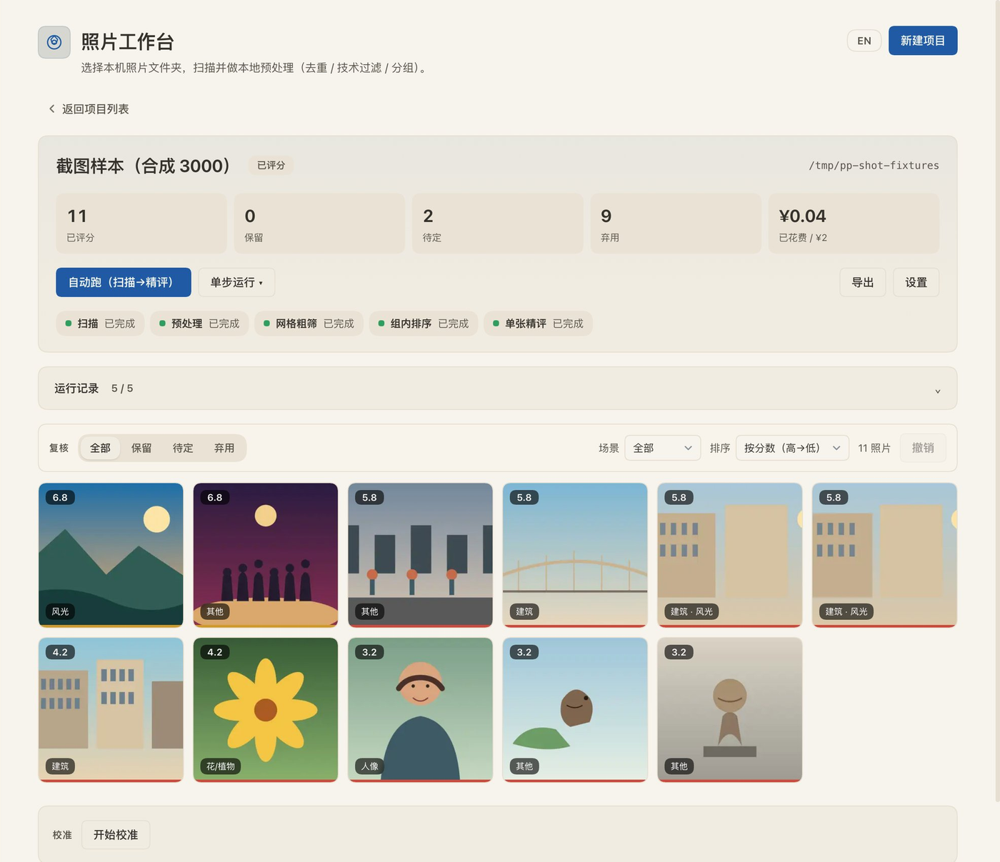
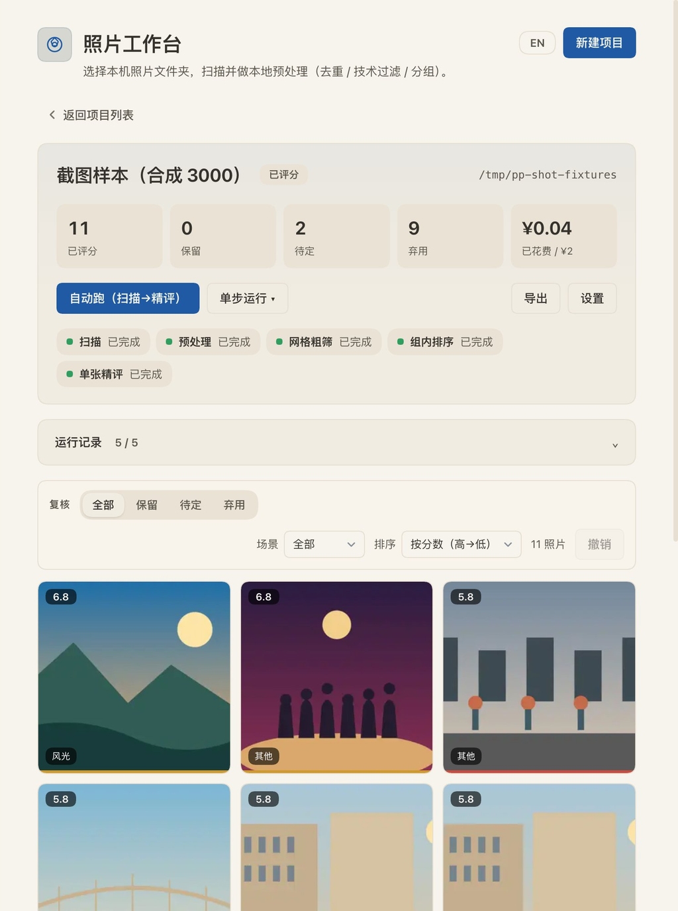
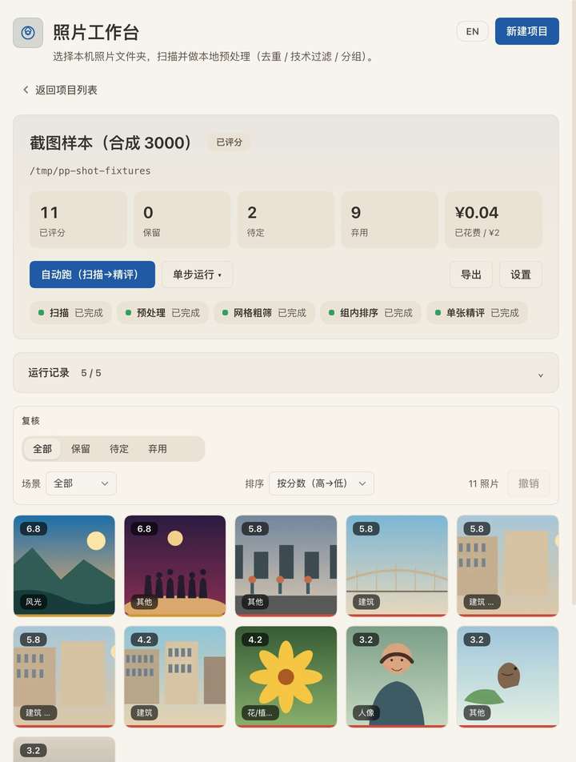
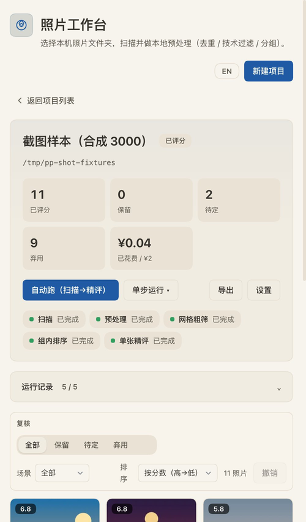
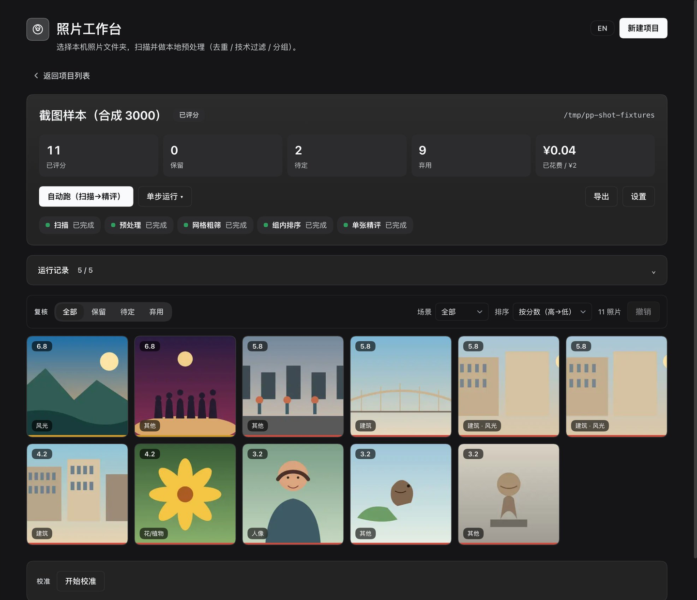
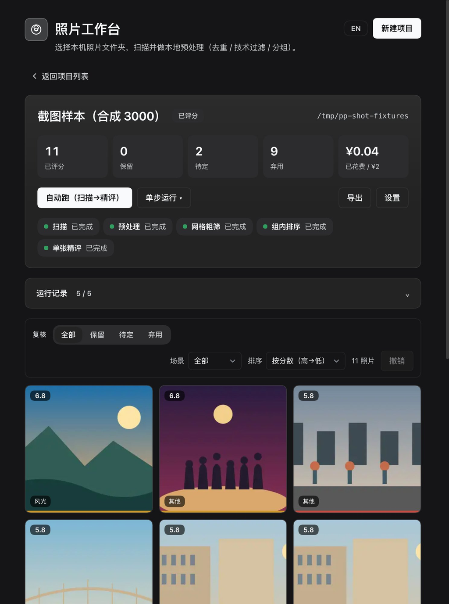
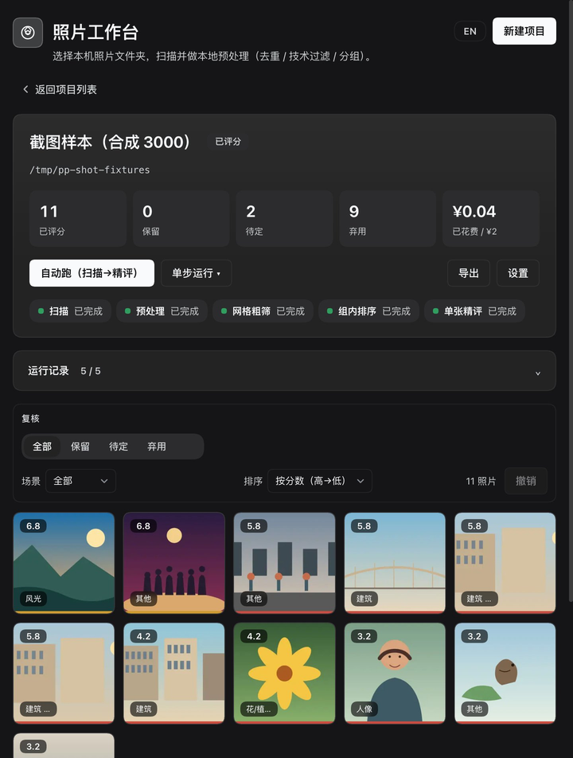
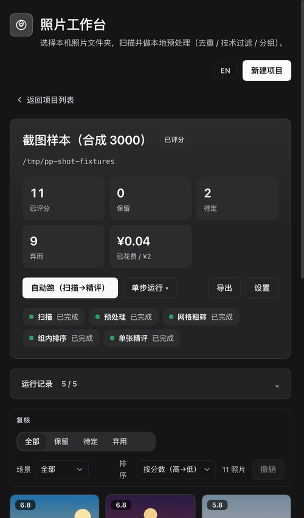

# 界面截图矩阵

合成素材截图，不含真实照片、个人路径或账号信息。

## Light

| 1440 | 1024 |
| --- | --- |
|  |  |

| 720 | 500 |
| --- | --- |
|  |  |

## Dark

| 1440 | 1024 |
| --- | --- |
|  |  |

| 720 | 500 |
| --- | --- |
|  |  |

> 计划目标是 480px；当前 Chrome 桌面窗口最小内容宽度为 500px，因此矩阵记录为 500px。
