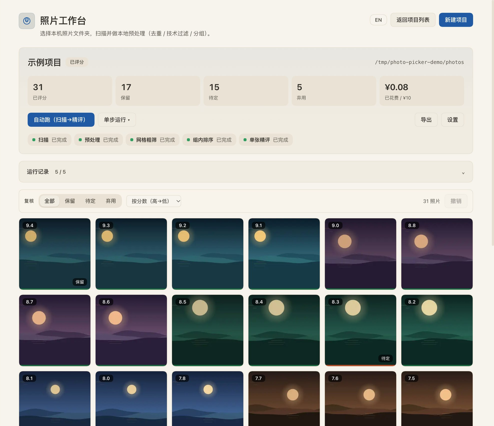
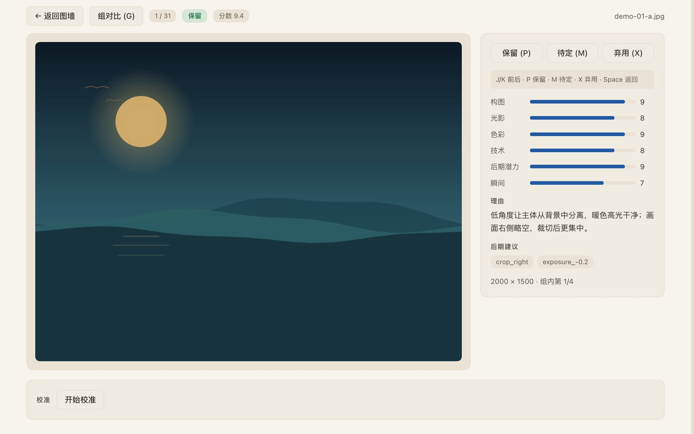
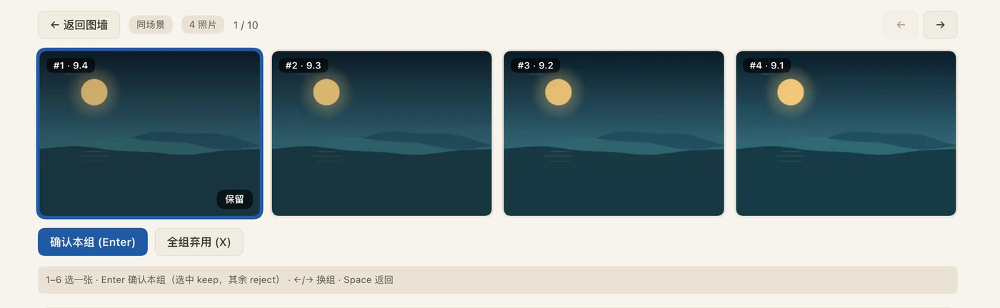
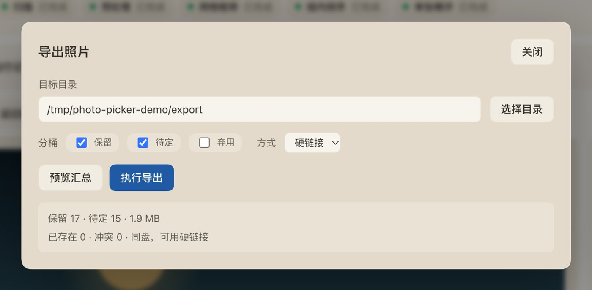

# dsh-photo-picker

> A photo-picking workbench for [DeepSeek Harness](https://github.com/deepseek-ai/deepseek-harness): scan local photos, deduplicate/filter/group them locally, triage with an image-capable model, review the shortlist, and export keep / maybe as a ready-to-use directory.

**Version 0.2.0** · [GitHub](https://github.com/uoiszero/dsh-photo-picker) · [npm](https://www.npmjs.com/package/dsh-photo-picker) · macOS / Windows · MIT

## Install

```bash
dsh plugin --profile web add dsh-photo-picker
dsh web
```

The npm package contains the built client bundle, so no local clone or build step is required. Open **Photo Picker / 照片工作台** from the DSH sidebar.

## What it does

```text
choose a folder
  ├─ scan (EXIF / file list)
  ├─ local preprocess (dedupe, blur/exposure/size filters, burst/scene grouping, thumbnails)
  ├─ AI grid triage (4×4 contact sheets, one call per grid)
  ├─ group ranking (keep the best 1–2 of a burst/scene)
  ├─ single-photo scoring (six dimensions + keep/maybe/reject + edit recipe)
  ├─ human review (wall / single / group compare, batch decisions and undo)
  ├─ calibration (blind sample → precision / recall / F1 / suggested thresholds)
  └─ export (hardlink or copy + manifest, source stays read-only)
```

All state lives in a local SQLite project database. Stages can pause, resume from a cursor, and never re-charge for completed AI work.

## Features

- **Local first**: scanning, dedupe, technical filters, burst/scene grouping and thumbnails run on your machine.
- **Layered AI**: grid triage → group ranking → single-photo scoring. Human decisions always override AI.
- **Budget and stability**: live USD/CNY usage, budget pause, concurrency/retry/backoff, off-peak mode, resumable stages.
- **Review workbench**: filterable wall, 1600px single view, group compare, bulk decisions, undo.
- **Portable edit recipes**: the scoring model can suggest crop/straighten/exposure/contrast/saturation/sharpen. The plugin renders them with the bundled sharp engine, previews original vs. edited from the image badge, shows rule-of-thirds/crosshair guides, and exports JPEG copies while keeping sources untouched.
- **No black corners**: straightening auto-crops the largest inscribed rectangle.
- **No micro-crops**: recipes whose trimmed edges are all below 18% are treated as uncropped; the UI shows retained size and offsets.
- **Calibration and export**: blind-sample calibration, bucket export, hardlink/copy, `manifest.csv` + `manifest.json`, source-integrity checks.

## Requirements

- DSH with the Web UI; Node **22.23+** (uses `node:sqlite`).
- macOS: `sips` / `osascript` / `open` for HEIC/RAW, folder picker and Finder reveal.
- Windows 10/11: PowerShell 5.1 + WIC + `explorer`; HEIC/RAW need the system HEIF/HEVC and Raw Image Extension.
- An **image-capable model route** supplied by you. The plugin bundles no model, credentials or quota. Models without image input are disabled in settings.

## Screenshots









Screenshots use synthetic fixture images and simulated scores; no real photos or account data are included.

## Links

- [Full README, design spec and plans](https://github.com/uoiszero/dsh-photo-picker)
- [Plan 5: portable edit recipes](https://github.com/uoiszero/dsh-photo-picker/blob/main/docs/superpowers/plans/2026-11-13-photo-picker-05-edit-recipes.md)
- [Issues](https://github.com/uoiszero/dsh-photo-picker/issues)

## License

MIT. Copyright (c) 2026 uoiszero.
