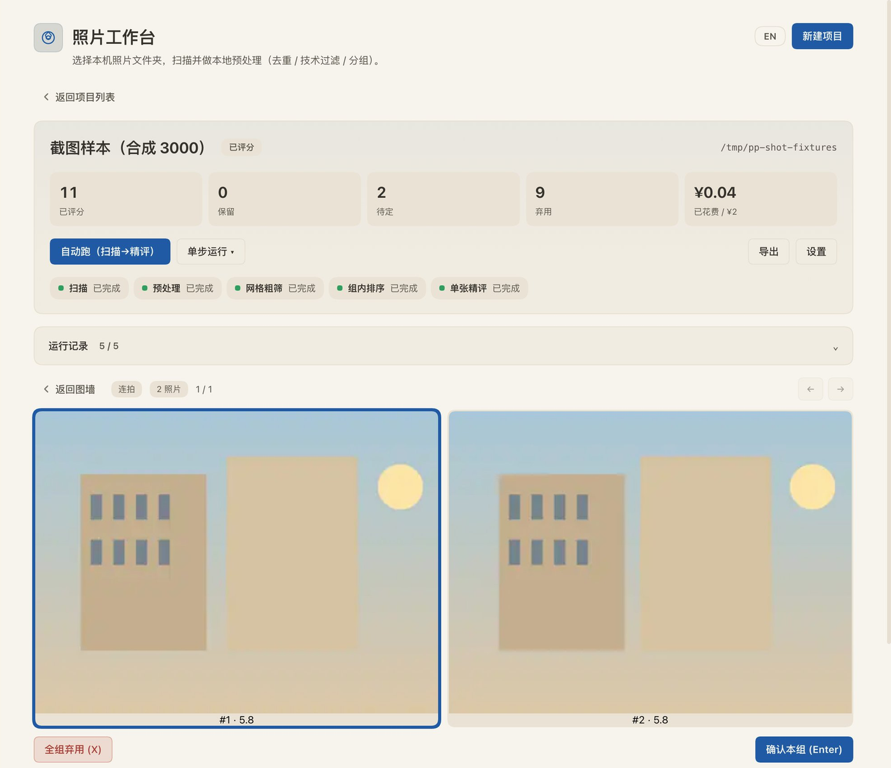

# dsh-photo-picker

> A photo-picking workbench for [DeepSeek Harness](https://github.com/deepseek-ai/deepseek-harness): scan local photos, deduplicate/filter/group them locally, triage with an image-capable model, review the shortlist, and export keep / maybe as a ready-to-use directory.

**Version 0.5.0** · [GitHub](https://github.com/uoiszero/dsh-photo-picker) · [npm](https://www.npmjs.com/package/dsh-photo-picker) · macOS / Windows · MIT

## Install

```bash
dsh plugin --profile web add dsh-photo-picker
dsh web
```

The npm package contains the built client bundle, so no local clone or build step is required. Open **Photo Picker / 照片工作台** from the DSH sidebar.

## What it does

```text
choose a folder
  ├─ scan (EXIF / file list)
  ├─ local preprocess (dedupe, blur/exposure/size filters, burst/scene grouping, thumbnails)
  ├─ AI grid triage (4×4 contact sheets, one call per grid)
  ├─ group ranking (keep the best 1–2 of a burst/scene)
  ├─ single-photo scoring (six dimensions + keep/maybe/reject + edit recipe)
  ├─ human review (wall / single / group compare, batch decisions and undo)
  ├─ calibration (blind sample → precision / recall / F1 / suggested thresholds)
  └─ export (hardlink or copy + manifest, source stays read-only)
```

All state lives in a local SQLite project database. Stages can pause, resume from a cursor, and never re-charge for completed AI work.

## Features

- **Model routes**: choose a provider route and image-capable model per project; the default is DeepSeek Flash, with other routes available as alternatives.
- **Local first**: scanning, dedupe, technical filters, burst/scene grouping and thumbnails run on your machine.
- **Layered AI**: grid triage → group ranking → single-photo scoring. Single-photo scoring detects the scene (portrait / landscape / architecture / street / event / other) and adapts its criteria; human decisions always override AI.
- **Budget and stability**: live USD/CNY usage, budget pause, concurrency/retry/backoff, off-peak mode, resumable stages.
- **Project management**: delete a project and its local workspace without touching source photos.
- **Review workbench**: filterable wall with AI scene tags and scene filters, 1600px single view, group compare, bulk decisions, undo.
- **Portable edit recipes**: the scoring model can suggest crop/straighten/exposure/contrast/saturation/sharpen. Tune exposure/contrast/saturation/sharpen/rotate in the single view, save a per-photo human recipe, or restore the AI recipe. The plugin renders previews with the bundled sharp engine and exports JPEG copies while keeping sources untouched. Crop stays from the AI suggestion.
- **No black corners**: straightening auto-crops the largest inscribed rectangle.
- **No micro-crops**: recipes whose trimmed edges are all below 18% are treated as uncropped; the UI shows retained size and offsets.
- **Calibration and export**: blind-sample calibration, bucket export, hardlink/copy, `manifest.csv` + `manifest.json` with scene columns and `editSource`, source-integrity checks.
- **Unified UI**: shared buttons/forms/tabs/state cards, consistent back/close and primary-action placement, responsive layouts, dark-theme-aware status colors, and a `check:ui` guard against inline visual styles.
- **Scene-aware review**: per-photo scene tags (portrait / landscape / architecture / street / event / flower / wildlife / sculpture / other), manual tag correction, scene filters, and a virtualized page-200 review wall that can reach every photo.

## Requirements

- DSH with the Web UI; Node **22.23+** (uses `node:sqlite`).
- macOS: `sips` / `osascript` / `open` for HEIC/RAW, folder picker and Finder reveal.
- Windows 10/11: PowerShell 5.1 + WIC + `explorer`; HEIC/RAW need the system HEIF/HEVC and Raw Image Extension.
- An **image-capable model route** supplied by you. The plugin bundles no model, credentials or quota. Models without image input are disabled in settings.

## Screenshots





Screenshots use synthetic fixture images and simulated scores; no real photos or account data are included. The image filenames include 2026-11 so GitHub/npm caches pick up the current UI.

## Links

- [Full README, design spec and plans](https://github.com/uoiszero/dsh-photo-picker)
- [Plan 5: portable edit recipes](https://github.com/uoiszero/dsh-photo-picker/blob/main/docs/superpowers/plans/2026-11-13-photo-picker-05-edit-recipes.md)
- [Plan 6: UI consistency](https://github.com/uoiszero/dsh-photo-picker/blob/main/docs/superpowers/plans/2026-11-15-photo-picker-06-ui-consistency.md)
- [Issues](https://github.com/uoiszero/dsh-photo-picker/issues)

## License

MIT. Copyright (c) 2026 uoiszero.
