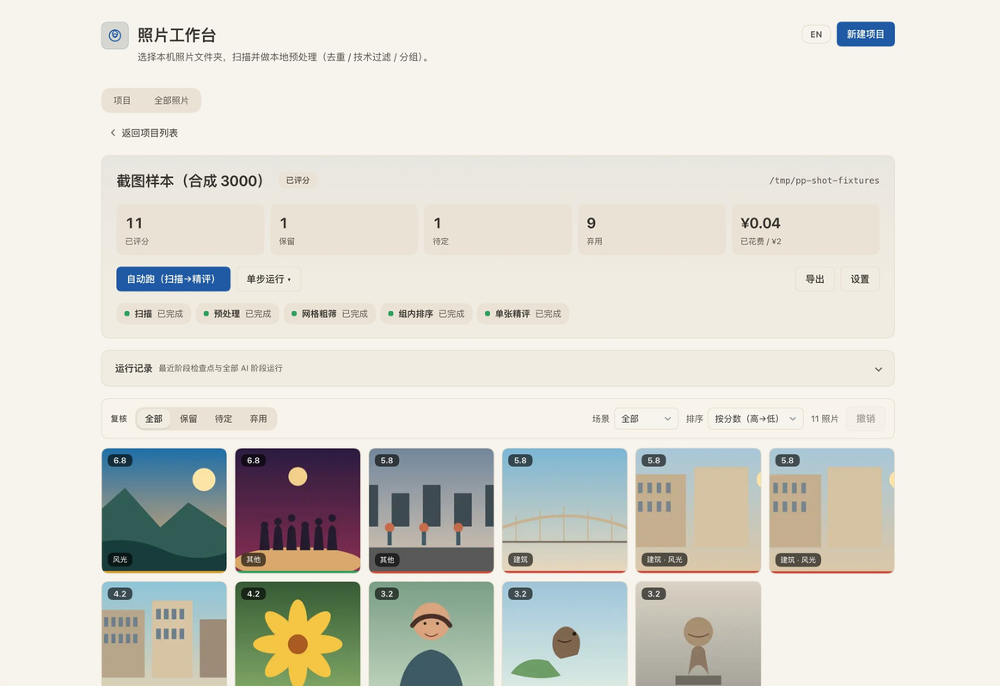
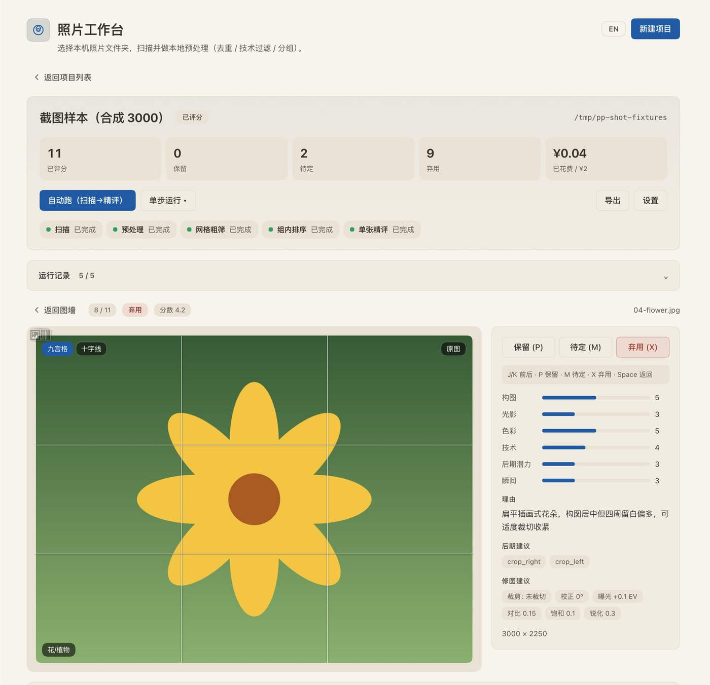
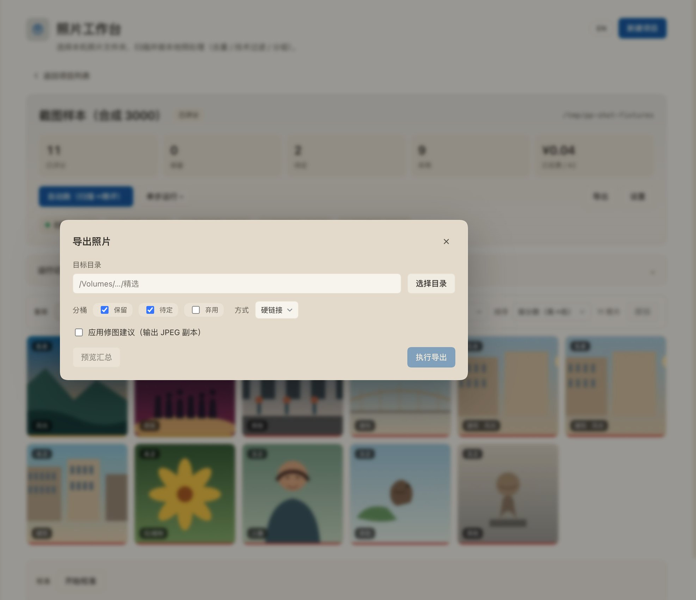
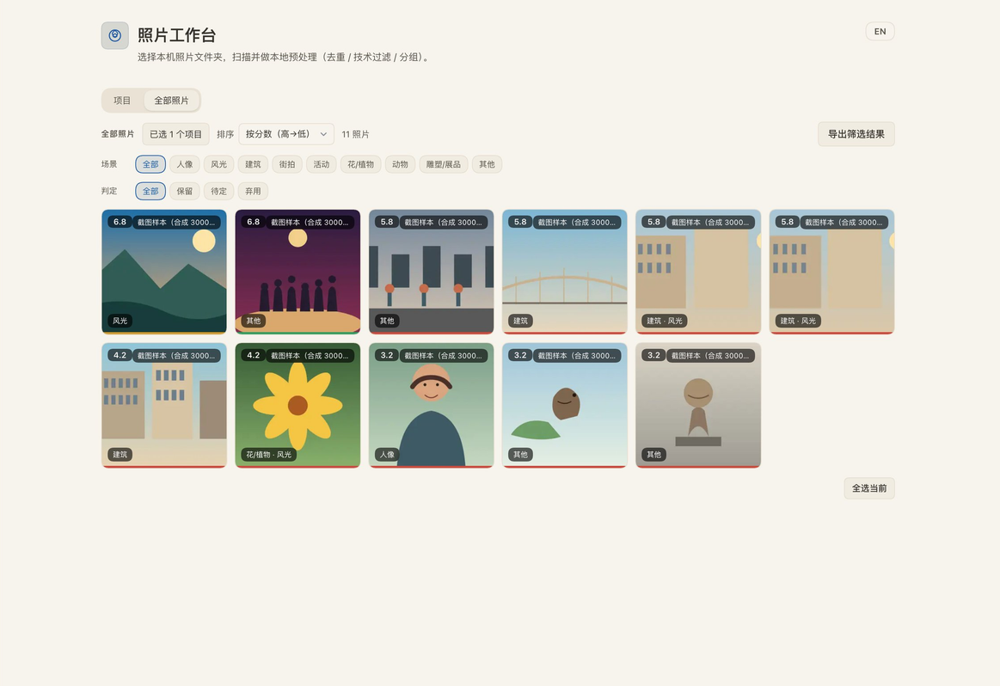

# dsh-photo-picker

> A photo-picking workbench for [DeepSeek Harness](https://github.com/deepseek-ai/deepseek-harness): scan local photos, deduplicate/filter/group them locally, triage with an image-capable model, review the shortlist, and export keep / maybe as a ready-to-use directory.

**Version 0.7.1** · [GitHub](https://github.com/uoiszero/dsh-photo-picker) · [npm](https://www.npmjs.com/package/dsh-photo-picker) · macOS / Windows · MIT

## Install

```bash
dsh plugin --profile web add dsh-photo-picker
dsh web
```

The npm package contains the built client bundle, so no local clone or build step is required. Open **Photo Picker / 照片工作台** from the DSH sidebar.

## What it does

```text
choose a folder
  ├─ scan (EXIF / file list)
  ├─ local preprocess (dedupe, blur/exposure/size filters, burst/scene grouping, thumbnails)
  ├─ AI grid triage (4×4 contact sheets, one call per grid)
  ├─ group ranking (keep the best 1–2 of a burst/scene)
  ├─ single-photo scoring (six dimensions + keep/maybe/reject + edit recipe)
  ├─ human review (wall / single / group compare, batch decisions and undo)
  ├─ calibration (blind sample → precision / recall / F1 / suggested thresholds)
  └─ export (hardlink or copy + manifest, source stays read-only)
```

All state lives in a local SQLite project database. Stages can pause, resume from a cursor, and never re-charge for completed AI work.

## Features

- **Model routes**: choose a provider route and image-capable model per project; the default is DeepSeek Flash, with other routes available as alternatives.
- **Local first**: scanning, dedupe, technical filters, burst/scene grouping and thumbnails run on your machine.
- **Layered AI**: grid triage → group ranking → single-photo scoring. Single-photo scoring detects the scene (portrait / landscape / architecture / street / event / flower / wildlife / sculpture / other) and adapts its criteria; human decisions always override AI.
- **Budget and stability**: live CNY usage, budget pause, concurrency/retry/backoff, off-peak mode, resumable stages.
- **Project management**: delete a project and its local workspace without touching source photos.
- **Review workbench**: filterable wall with AI scene tags and scene filters, 1600px single view, group compare, bulk decisions, undo.
- **Cross-project wall**: filter reviewable photos from multiple projects by scene label, verdict and project; sort by score/time/project; export the filtered set or a selection with a single manifest.
- **Curves**: per-photo RGB master curve, independent red/green/blue channel curves, and a brightness curve that adjusts luminance while preserving hue. Click to add, drag, double-click to remove; curves render locally through a 256-step LUT.
- **Built-in curve presets**: soft/strong contrast, shadow lift, highlight rolloff, matte fade, warm film and cool cinema, available without a custom template.
- **Style presets**: select 1–5 existing project photos on the all-photos or project wall, optionally let one image-model call analyze a contact sheet, and save a global tone/color preset. Applying a preset never calls the model; failures fall back to local histogram statistics.
- **AI run history**: per-project stage-level model/token/cost/call/error history for grid, rank and score, with a unified checkpoint/AI-history card.
- **Portable edit recipes**: manual crop with freeform, 4:3 / 5:4 / 1:1 / 16:9 / 16:10 / 3:2 presets, orientation swap, and draggable handles. Tune exposure/contrast/saturation/sharpen/rotate, save a per-photo human recipe, or restore the AI recipe. The plugin renders previews with the bundled sharp engine and exports JPEG copies while keeping sources untouched.
- **No black corners**: straightening auto-crops the largest inscribed rectangle.
- **No AI micro-crops**: AI recipes whose trimmed edges are all below 18% are treated as uncropped; manual crops are preserved. The UI shows retained size and offsets.
- **Calibration and export**: blind-sample calibration, bucket export, hardlink/copy, `manifest.csv` + `manifest.json` with scene columns and `editSource`, source-integrity checks.
- **Unified UI**: shared buttons/forms/tabs/state cards, consistent back/close and primary-action placement, responsive layouts, dark-theme-aware status colors, and a `check:ui` guard against inline visual styles.
- **Scene-aware review**: per-photo scene tags (portrait / landscape / architecture / street / event / flower / wildlife / sculpture / other), manual tag correction, scene filters, and a virtualized page-200 review wall that can reach every photo.
- **Export progress and persistence**: estimated virtual export progress, a completion toast, and in-memory project/photo-wall scroll restoration.
- **Node compatibility**: Node 22.23+ is the baseline; the scan path is also verified on Node 26 (avoids the exifr FileHandle leak).
- **Style preset storage**: global templates live in `$DSH_HOME/storages/photo-picker/style-presets.json`; no source paths or images are stored in the preset file.

## Requirements

- DSH with the Web UI; Node **22.23+** (uses `node:sqlite`).
- macOS: `sips` / `osascript` / `open` for HEIC/RAW, folder picker and Finder reveal.
- Windows 10/11: PowerShell 5.1 + WIC + `explorer`; HEIC/RAW need the system HEIF/HEVC and Raw Image Extension.
- An **image-capable model route** supplied by you. The plugin bundles no model, credentials or quota. Models without image input are disabled in settings.

## Screenshots










Screenshots use synthetic fixture images and simulated scores; no real photos or account data are included. Project detail and cross-project wall show the 0.7 UI; the other images illustrate the same flows.

## Links

- [Full README, design spec and plans](https://github.com/uoiszero/dsh-photo-picker)
- [Plan 5: portable edit recipes](https://github.com/uoiszero/dsh-photo-picker/blob/main/docs/superpowers/plans/2026-11-13-photo-picker-05-edit-recipes.md)
- [Plan 6: UI consistency](https://github.com/uoiszero/dsh-photo-picker/blob/main/docs/superpowers/plans/2026-11-15-photo-picker-06-ui-consistency.md)
- [Issues](https://github.com/uoiszero/dsh-photo-picker/issues)

## License

MIT. Copyright (c) 2026 uoiszero.
